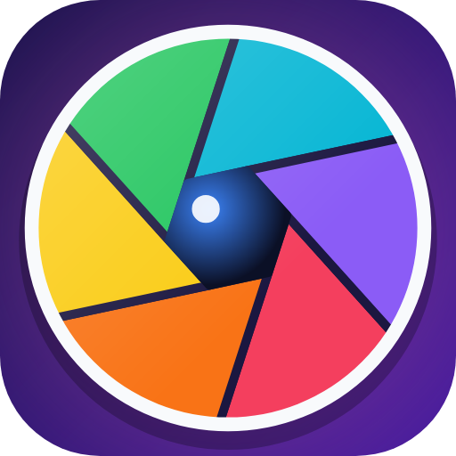
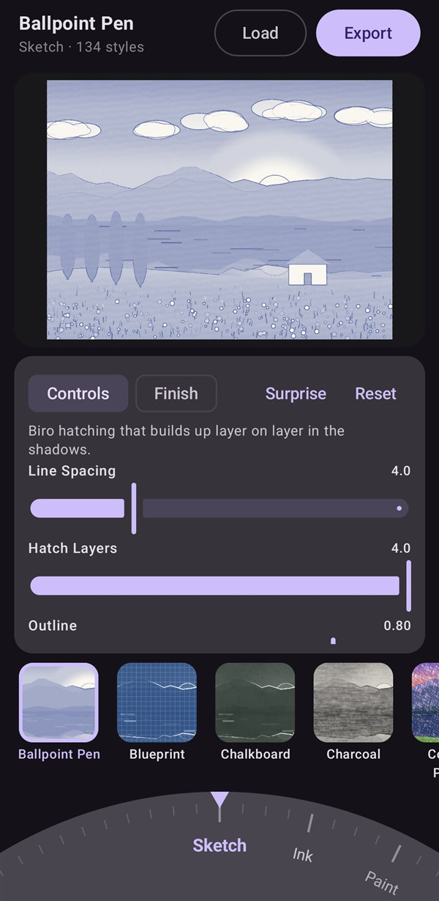
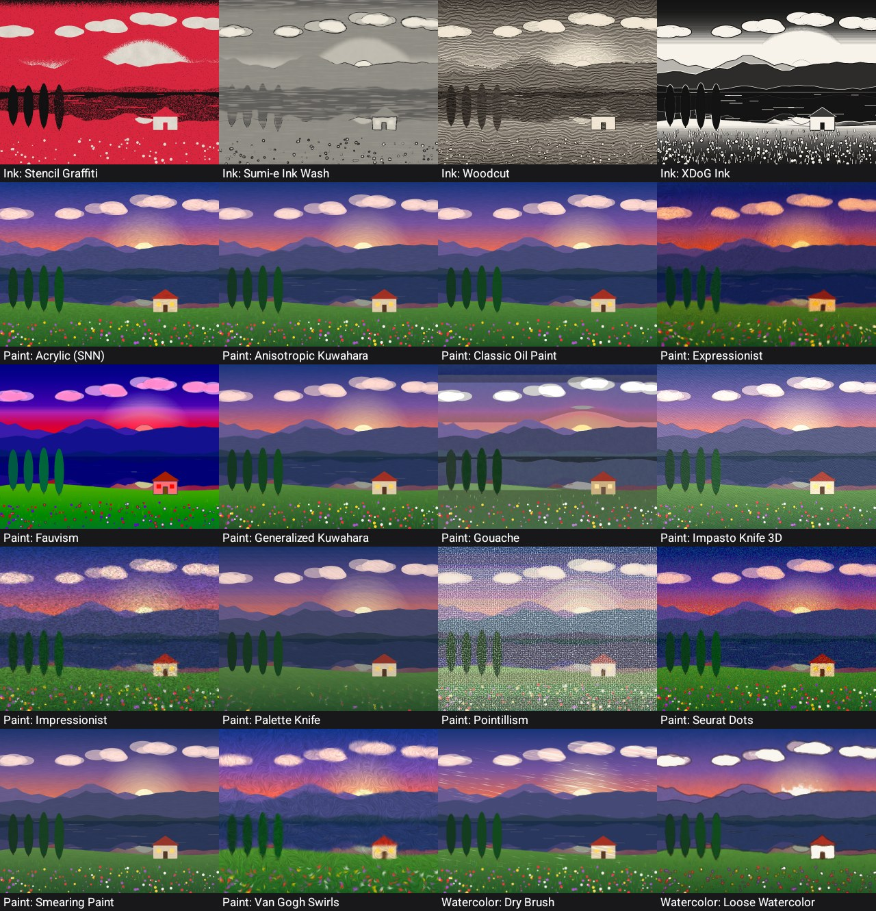
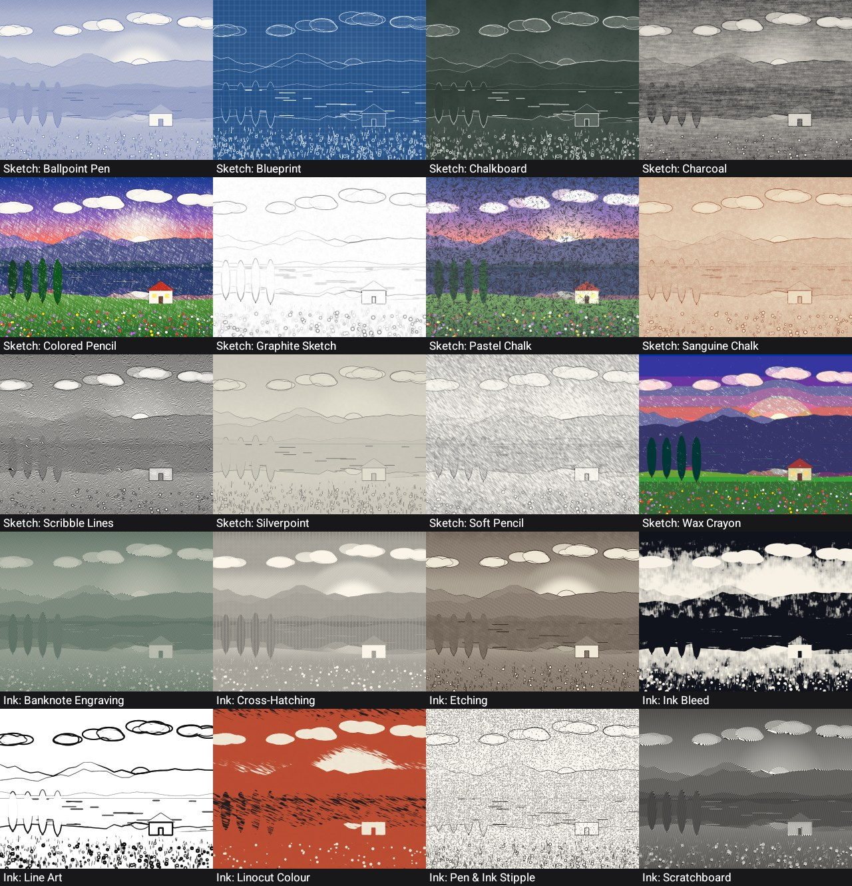
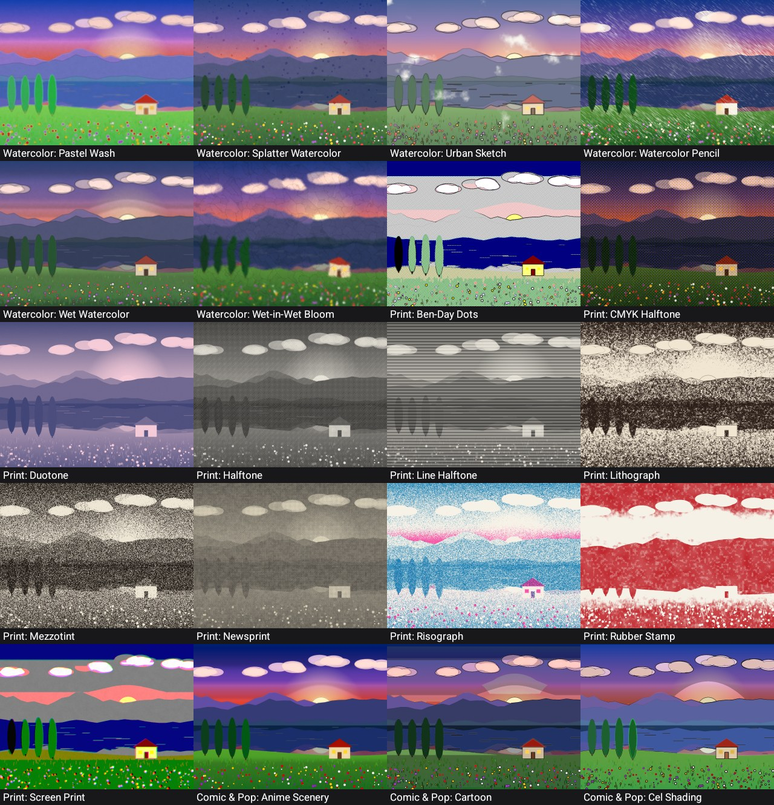
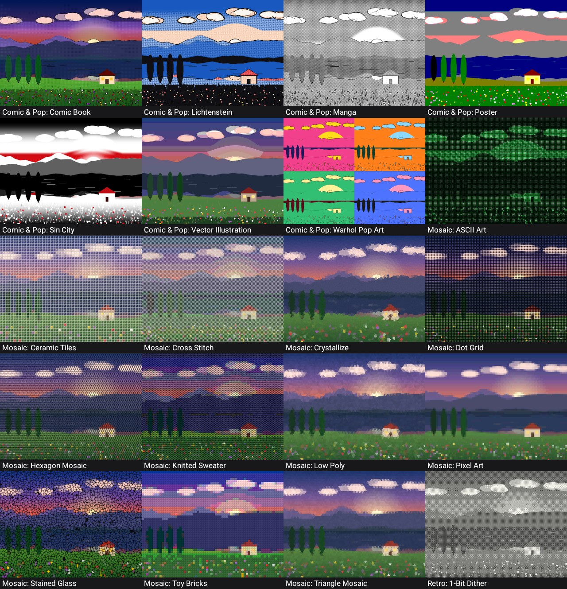
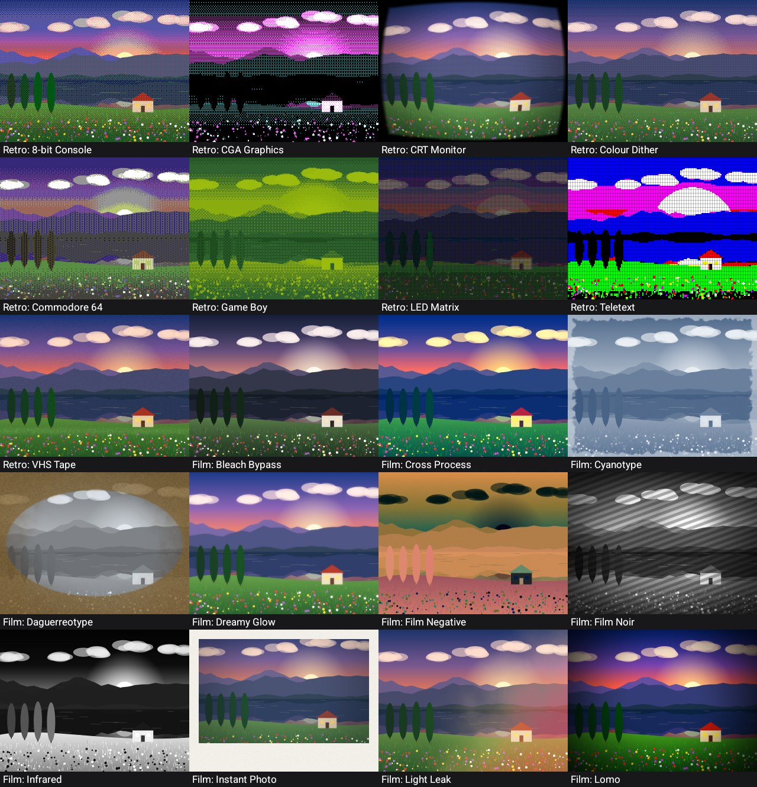
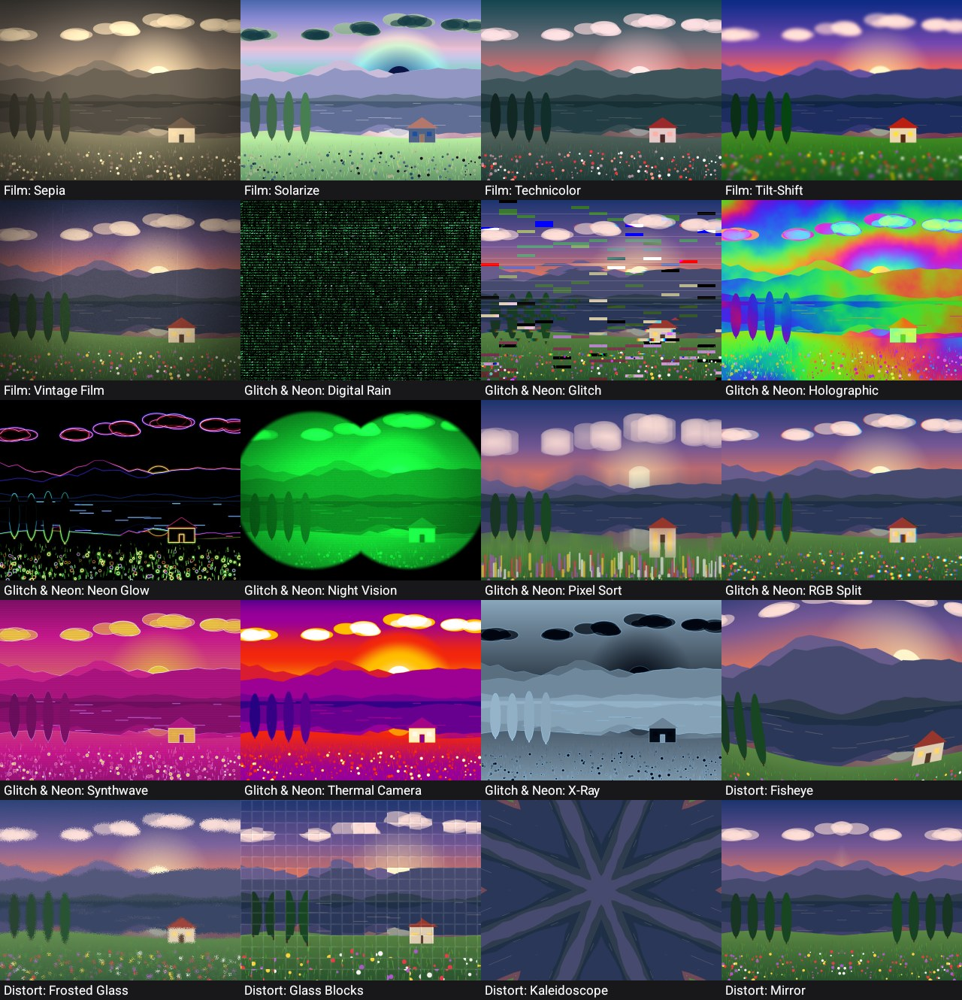
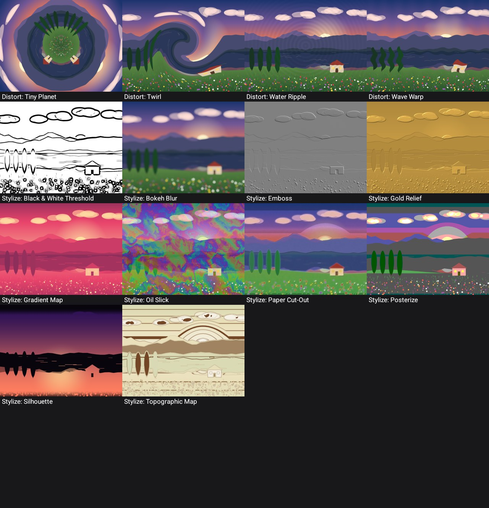

<p align="center">
  
</p>

<h1 align="center">Artisan NPR Studio</h1>

<p align="center">
  <b>Photo art filters for Android.</b> Turn your photos into pencil sketches, oil paintings, watercolours, comics, retro pixels, film looks and more, with 134 styles.<br>
  Fully offline. No AI models, no accounts, no permissions.
</p>

<p align="center">
  <a href="https://github.com/R-Dilipkumar/photo-art-filters-android/releases/latest"></a>
  <a href="LICENSE"></a>
  
  
  
  
</p>

<p align="center">
  
</p>

## Features

- **134 art styles in 12 groups.** Turn the **dial** at the bottom to pick a group, then tap a live thumbnail.
- **Controls per style.** Each style has its own sliders, colour pickers, on/off switches and choices, with up to 8 per style.
- **Finish tab, shared by all styles:** strength (blend with the photo), brightness, contrast, saturation, optional ink outlines, and Floyd–Steinberg dithering.
- **Surprise** picks random settings. **Reset** goes back to the defaults.
- Press and hold the picture to compare it with the original.
- **Export** a high-resolution copy (up to 3200 px) to `Pictures/ArtisanNPR`. It looks the same as the preview.
- Fast: one background GPU thread keeps everything loaded, so a slider move just redraws the picture.
- Works with no internet and asks for no permissions. The APK is about 2 MB.

## Download

**[Download the latest APK](https://github.com/R-Dilipkumar/photo-art-filters-android/releases/latest/download/photo-art-filters-android.apk)**. Or see all [releases](https://github.com/R-Dilipkumar/photo-art-filters-android/releases).

1. Download the APK on your phone.
2. Open it. If Android asks, allow installs from your browser or file manager.
3. Open **Artisan NPR Studio**, tap **Load** to pick a photo, turn the dial, and tap a style.

## Styles

<p align="center"></p>

| Group | Styles |
|---|---|
| Sketch (12) | Ballpoint Pen, Blueprint, Chalkboard, Charcoal, Colored Pencil, Graphite Sketch, Pastel Chalk, Sanguine Chalk, Scribble Lines, Silverpoint, Soft Pencil, Wax Crayon |
| Ink (12) | Banknote Engraving, Cross-Hatching, Etching, Ink Bleed, Line Art, Linocut Colour, Pen & Ink Stipple, Scratchboard, Stencil Graffiti, Sumi-e Ink Wash, Woodcut, XDoG Ink |
| Paint (14) | Acrylic (SNN), Anisotropic Kuwahara, Classic Oil Paint, Expressionist, Fauvism, Generalized Kuwahara, Gouache, Impasto Knife 3D, Impressionist, Palette Knife, Pointillism, Seurat Dots, Smearing Paint, Van Gogh Swirls |
| Watercolor (8) | Dry Brush, Loose Watercolor, Pastel Wash, Splatter Watercolor, Urban Sketch, Watercolor Pencil, Wet Watercolor, Wet-in-Wet Bloom |
| Print (11) | Ben-Day Dots, CMYK Halftone, Duotone, Halftone, Line Halftone, Lithograph, Mezzotint, Newsprint, Risograph, Rubber Stamp, Screen Print |
| Comic & Pop (10) | Anime Scenery, Cartoon, Cel Shading, Comic Book, Lichtenstein, Manga, Poster, Sin City, Vector Illustration, Warhol Pop Art |
| Mosaic (12) | ASCII Art, Ceramic Tiles, Cross Stitch, Crystallize, Dot Grid, Hexagon Mosaic, Knitted Sweater, Low Poly, Pixel Art, Stained Glass, Toy Bricks, Triangle Mosaic |
| Retro (10) | 1-Bit Dither, 8-bit Console, CGA Graphics, CRT Monitor, Colour Dither, Commodore 64, Game Boy, LED Matrix, Teletext, VHS Tape |
| Film (16) | Bleach Bypass, Cross Process, Cyanotype, Daguerreotype, Dreamy Glow, Film Negative, Film Noir, Infrared, Instant Photo, Light Leak, Lomo, Sepia, Solarize, Technicolor, Tilt-Shift, Vintage Film |
| Glitch & Neon (10) | Digital Rain, Glitch, Holographic, Neon Glow, Night Vision, Pixel Sort, RGB Split, Synthwave, Thermal Camera, X-Ray |
| Distort (9) | Fisheye, Frosted Glass, Glass Blocks, Kaleidoscope, Mirror, Tiny Planet, Twirl, Water Ripple, Wave Warp |
| Stylize (10) | Black & White Threshold, Bokeh Blur, Emboss, Gold Relief, Gradient Map, Oil Slick, Paper Cut-Out, Posterize, Silhouette, Topographic Map |

<details>
<summary><b>See every style</b> (contact sheets on the built-in sample picture)</summary>









</details>

## How it works

Each style is a small GPU program (an OpenGL ES 3.0 fragment shader) in its own file under `app/src/main/assets/shaders/`. Many are well-known image-art methods: colour-dodge sketching, Winnemöller's XDoG, classic and 8-sector Kuwahara (Papari), the symmetric-nearest-neighbour filter, line integral convolution for brush strokes, bilateral filtering, CMYK halftone screens, Bayer and Floyd–Steinberg dithering, and Voronoi mosaics.

- On a mid-range phone (Mali-G720), a 1280 px preview renders in **13 ms on average**, and the slowest style takes 52 ms.
- Wide effects read from pre-blurred copies of the photo (mipmaps), so they cost the same at any size. Sizes are set relative to the image, which is why the 3200 px export matches the preview.

## Add your own style

1. Copy [`tools/shader_template.frag`](tools/shader_template.frag) to `app/src/main/assets/shaders/my_style.frag`.
2. Edit the header. It sets the name, the dial group, and the controls:

   ```glsl
   // @name My Style
   // @category Stylize
   // @desc One line shown above the controls.
   // @param  uAmount "Amount" 0.0 1.0 0.5
   // @color  uTint "Tint" #E8436B
   // @toggle uInvert "Invert" 0
   // @choice uMode "Mode" "Soft|Hard" 0

   vec3 effect(vec2 uv) {
       return mix(src(uv), uTint, uAmount);
   }
   ```

3. Check it: `python tools/check_shaders.py my_style`
4. Build and run. The style shows up on its own, and a new `@category` name becomes a new spot on the dial.

You write one function, `vec3 effect(vec2 uv)`. The shared helpers in [`prelude.glsl`](app/src/main/assets/glsl/prelude.glsl) (blur, edges, Kuwahara, noise, dithering, colour tools and more) are listed in the template.

## Good to know

- Needs Android 10 or newer and a GPU with OpenGL ES 3.0 (almost every phone from the last 8+ years).
- The preview works at up to 1280 px. Export works at up to 3200 px, or the GPU's limit if that is lower.
- Ink outlines and Floyd–Steinberg dithering run on the CPU, so they add a little time to each update.
- The app started from a research blueprint. [`AUDIT.md`](AUDIT.md) records the problems found in it and how they were fixed.

## Build from source

Requirements: JDK 17+ and the Android SDK (platform 36). The NDK is optional; it's only needed for the shader check.

```bash
git clone https://github.com/R-Dilipkumar/photo-art-filters-android.git
```

```bash
./gradlew assembleDebug
```

The APK is written to `app/build/outputs/apk/debug/`. For a signed release build, add a `keystore.properties` in the project root (`storeFile`, `storePassword`, `keyAlias`, `keyPassword`) and run `./gradlew assembleRelease`. Without that file, the release build is unsigned.

Check that every shader compiles and its header is valid (uses `glslc` from the Android NDK):

```bash
python tools/check_shaders.py
```

Run the tests: the parser tests on your computer, and the GPU tests on a phone or emulator. The GPU tests render every style at its default, minimum and maximum settings.

```bash
./gradlew testDebugUnitTest connectedDebugAndroidTest
```

Render every style into contact sheets on a connected phone (optionally on your own photo):

```bash
bash tools/contact_sheets.sh path/to/photo.jpg
```

## License

MIT, © 2026 Dilipkumar R. See [LICENSE](LICENSE).
